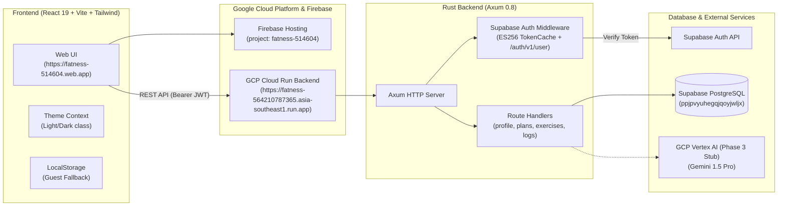
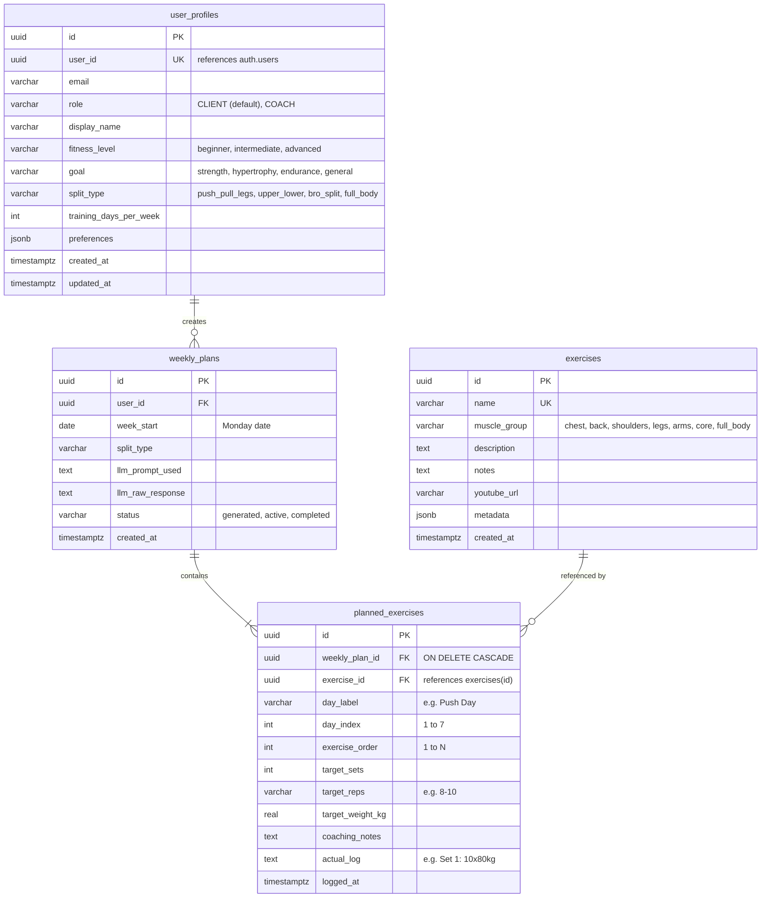

# 🏋️ Fatness — Technical Documentation & Architecture Guide

> **Primary Audience:** AI Agents, Developers, and Maintainers.  
> **Purpose:** Provide an instant, complete index of every page, file, API endpoint, database table, and deployment mechanism so that any AI agent or engineer can navigate and modify the codebase **without scanning the entire repository**.

---

## 📑 Quick Navigation for AI Agents (Page-to-File Matrix)

When the user asks to modify or implement something on a specific page, use this table to jump directly to the relevant files:

| Page / Route | Primary File | Supporting Hooks & Libs | Backend Endpoints Called | LocalStorage Keys (Guest Mode) | Key Features & Elements |
|---|---|---|---|---|---|
| **Dashboard** (`/` or `/dashboard`) | [`frontend/src/pages/Dashboard.tsx`](file:///Users/admin/code/fatness/frontend/src/pages/Dashboard.tsx) | [`useAuth.tsx`](file:///Users/admin/code/fatness/frontend/src/hooks/useAuth.tsx), [`api.ts`](file:///Users/admin/code/fatness/frontend/src/lib/api.ts) | `GET /plans/current`, `POST /plans`, `PUT /plans/{id}/reorder`, `GET /exercises` | `fatness_current_plan` | Weekly completion progress bar, Sessions grid, **In-place Edit Mode** (add/remove/reorder exercises from session), direct link to workout session. |
| **Workout Session Log** (`/workout/:dayIndex`) | [`frontend/src/pages/Workout.tsx`](file:///Users/admin/code/fatness/frontend/src/pages/Workout.tsx) | [`useAuth.tsx`](file:///Users/admin/code/fatness/frontend/src/hooks/useAuth.tsx), [`api.ts`](file:///Users/admin/code/fatness/frontend/src/lib/api.ts) | `GET /plans/current`, `PATCH /planned-exercises/{id}/log` | `fatness_current_plan` | Day switcher (Prev/Next Day), exercise target cards (sets/reps/weight), YouTube form tutorial link, actual performance textarea, Save Set Log button. |
| **Plan Builder** (`/builder`) | [`frontend/src/pages/PlanBuilder.tsx`](file:///Users/admin/code/fatness/frontend/src/pages/PlanBuilder.tsx) | [`useAuth.tsx`](file:///Users/admin/code/fatness/frontend/src/hooks/useAuth.tsx), [`api.ts`](file:///Users/admin/code/fatness/frontend/src/lib/api.ts), [`mockData.ts`](file:///Users/admin/code/fatness/frontend/src/lib/mockData.ts) | `POST /plans`, `GET /exercises` | `fatness_current_plan` | Split template selector (`PPL`, `Upper/Lower`, `Bro Split`, `Full Body`), week start picker, custom day/exercise creator, drag/drop target parameters. |
| **Exercise Library** (`/exercises`) | [`frontend/src/pages/ExerciseCatalog.tsx`](file:///Users/admin/code/fatness/frontend/src/pages/ExerciseCatalog.tsx) | [`api.ts`](file:///Users/admin/code/fatness/frontend/src/lib/api.ts), [`mockData.ts`](file:///Users/admin/code/fatness/frontend/src/lib/mockData.ts) | `GET /exercises`, `POST /exercises`, `PUT /exercises/{id}`, `DELETE /exercises/{id}` | `fatness_exercises_catalog` | Search bar, muscle group filter pills (`chest`, `back`, `shoulders`, etc.), **Create Exercise Modal**, **Edit Exercise Modal**, Delete button, YouTube tutorial links. |
| **User Settings & Profile** (`/settings`) | [`frontend/src/pages/Settings.tsx`](file:///Users/admin/code/fatness/frontend/src/pages/Settings.tsx) | [`useAuth.tsx`](file:///Users/admin/code/fatness/frontend/src/hooks/useAuth.tsx), [`api.ts`](file:///Users/admin/code/fatness/frontend/src/lib/api.ts) | `GET /profile`, `PUT /profile`, `POST /profile` | `fatness_user_profile` | Display name, fitness level (`beginner`, `intermediate`, `advanced`), primary goal (`strength`, `hypertrophy`, etc.), preferred split, training days slider, equipment notes. |
| **Login / Register** (`/login`) | [`frontend/src/pages/Login.tsx`](file:///Users/admin/code/fatness/frontend/src/pages/Login.tsx) | [`useAuth.tsx`](file:///Users/admin/code/fatness/frontend/src/hooks/useAuth.tsx), [`supabase.ts`](file:///Users/admin/code/fatness/frontend/src/lib/supabase.ts) | Supabase Auth API (`/auth/v1/*`) | `fatness_guest_mode` | Sign In / Create Account tabs, email + password fields, instant Guest/Demo mode bypass button. |
| **Global App Layout & Shell** | [`frontend/src/components/Layout.tsx`](file:///Users/admin/code/fatness/frontend/src/components/Layout.tsx) | [`useTheme.tsx`](file:///Users/admin/code/fatness/frontend/src/hooks/useTheme.tsx), [`useAuth.tsx`](file:///Users/admin/code/fatness/frontend/src/hooks/useAuth.tsx) | None | `fatness_theme` | Top Navbar, desktop nav links, user email display, **Light/Dark Mode toggle button**, Sign Out button, mobile bottom navigation bar. |

---

## 🏛️ System Architecture & Live Environments



### Live Infrastructure Details

- **Frontend URL:** `https://fatness-514604.web.app` (Firebase Hosting)
- **Backend API URL:** `https://fatness-564210787365.asia-southeast1.run.app` (GCP Cloud Run)
- **GCP Project:** `fatness-514604` (Project Number: `564210787365`, Region: `asia-southeast1`)
- **Supabase Project:** `ppjpvyuhegqjqoyjwljx` (`https://ppjpvyuhegqjqoyjwljx.supabase.co`)
- **GitHub Repository:** `https://github.com/pttd96/fatness` (Branch: `main`)

---

## 📁 Repository Directory Structure

```
fatness/
├── .github/
│   └── workflows/
│       └── deploy-frontend.yml      # CI/CD: Builds React & deploys to Firebase Hosting
├── backend/                         # Rust Axum REST API
│   ├── Cargo.toml                   # Axum 0.8, SQLx 0.8, Tokio 1.0, Reqwest, Serde
│   ├── Dockerfile                   # Multi-stage Docker build for GCP Cloud Run
│   └── src/
│       ├── main.rs                  # Axum app initialization, CORS, Route definitions
│       ├── config.rs                # Environment configuration loader
│       ├── errors.rs                # Unified AppError enum & HTTP response mapper
│       ├── handlers/
│       │   ├── mod.rs
│       │   ├── profile.rs           # GET, POST, PUT /profile
│       │   ├── exercises.rs         # GET, POST /exercises, GET, PUT, DELETE /exercises/{id}
│       │   ├── plans.rs             # GET, POST /plans, /plans/current, /plans/{id}, POST /plans/{id}/exercises
│       │   └── logs.rs              # PATCH /planned-exercises/{id}/log, DELETE /planned-exercises/{id}
│       ├── middleware/
│       │   ├── mod.rs
│       │   └── auth.rs              # Supabase Auth extractor (ES256 + TokenCache)
│       ├── models/
│       │   ├── mod.rs
│       │   ├── profile.rs           # UserProfile struct & DTOs
│       │   ├── exercise.rs          # Exercise struct & DTOs
│       │   ├── plan.rs              # WeeklyPlan, PlanSummary, CreatePlanRequest
│       │   └── planned_exercise.rs  # PlannedExercise, PlannedExerciseWithDetails
│       └── services/
│           ├── mod.rs
│           ├── exercise_matcher.rs  # Fuzzy matching exercise names against catalog
│           └── plan_generator.rs    # Vertex AI Gemini plan generation stub (Phase 3)
├── frontend/                        # React 19 + TypeScript + Vite SPA
│   ├── package.json                 # Dependencies: React 19, react-router-dom 7, lucide-react
│   ├── vite.config.ts               # Vite configuration
│   ├── tailwind.config.js           # Tailwind config (darkMode: 'class', brand emerald colors)
│   ├── index.html                   # HTML entrypoint with zero-flash theme pre-hydration
│   ├── firebase.json                # Firebase Hosting SPA rewrite configuration
│   └── src/
│       ├── main.tsx                 # React DOM mount point
│       ├── App.tsx                  # BrowserRouter & Route configuration
│       ├── index.css                # Tailwind directives & global resets
│       ├── types/
│       │   └── index.ts             # TypeScript interfaces (Exercise, Plan, Profile, etc.)
│       ├── hooks/
│       │   ├── useAuth.tsx          # Supabase auth session, signIn, signUp, guestMode
│       │   └── useTheme.tsx         # Light/Dark mode state & localStorage persistence
│       ├── lib/
│       │   ├── api.ts               # Typed fetch client with Bearer token injection
│       │   ├── supabase.ts          # Supabase client initialization
│       │   └── mockData.ts          # Default mock exercises & current plan for guest mode
│       ├── components/
│       │   └── Layout.tsx           # Navbar, Nav items, theme toggle, demo badge, logout
│       └── pages/
│           ├── Dashboard.tsx        # Overview, completion %, session cards, in-place edit mode
│           ├── Workout.tsx          # Set logging, coaching cues, YouTube tutorial embeds
│           ├── PlanBuilder.tsx      # Split templates, custom routine creator
│           ├── ExerciseCatalog.tsx  # Searchable library, create/edit modals, muscle filters
│           ├── Settings.tsx         # User profile preferences & target days
│           └── Login.tsx            # Auth forms & Instant Demo access
└── supabase/
    └── migrations/                  # Sequential SQL schema migrations
        ├── 20261113000001_create_user_profiles.sql
        ├── 20261113000002_create_exercises.sql
        ├── 20261113000003_create_weekly_plans.sql
        ├── 20261113000004_create_planned_exercises.sql
        ├── 20261113000005_enable_rls.sql
        └── 20261113000006_seed_exercises.sql
```

---

## 🔌 Backend API Route Directory

All routes are registered in [`backend/src/main.rs`](file:///Users/admin/code/fatness/backend/src/main.rs). **Notice: there is no `/api/` prefix.**

| Method | Endpoint | Handler Function | File Link | Description | Auth Required? |
|---|---|---|---|---|---|
| `GET` | `/health` | Inline closure | [`main.rs:80`](file:///Users/admin/code/fatness/backend/src/main.rs#L80) | Health check (returns `"OK"`) | No |
| `GET` | `/profile` | `get_profile` | [`handlers/profile.rs`](file:///Users/admin/code/fatness/backend/src/handlers/profile.rs) | Get logged-in user's profile | Yes |
| `POST` | `/profile` | `create_profile` | [`handlers/profile.rs`](file:///Users/admin/code/fatness/backend/src/handlers/profile.rs) | Create user profile | Yes |
| `PUT` | `/profile` | `update_profile` | [`handlers/profile.rs`](file:///Users/admin/code/fatness/backend/src/handlers/profile.rs) | Update user profile goals & split | Yes |
| `GET` | `/exercises` | `list_exercises` | [`handlers/exercises.rs`](file:///Users/admin/code/fatness/backend/src/handlers/exercises.rs) | List exercises (optional `?muscle_group=`) | Yes |
| `POST` | `/exercises` | `create_exercise` | [`handlers/exercises.rs`](file:///Users/admin/code/fatness/backend/src/handlers/exercises.rs) | Add custom exercise to library | Yes |
| `GET` | `/exercises/{id}` | `get_exercise` | [`handlers/exercises.rs`](file:///Users/admin/code/fatness/backend/src/handlers/exercises.rs) | Get exercise details | Yes |
| `PUT` | `/exercises/{id}` | `update_exercise` | [`handlers/exercises.rs`](file:///Users/admin/code/fatness/backend/src/handlers/exercises.rs) | Update exercise details | Yes |
| `DELETE` | `/exercises/{id}` | `delete_exercise` | [`handlers/exercises.rs`](file:///Users/admin/code/fatness/backend/src/handlers/exercises.rs) | Delete exercise | Yes |
| `GET` | `/plans` | `list_plans` | [`handlers/plans.rs`](file:///Users/admin/code/fatness/backend/src/handlers/plans.rs) | Paginated plan history | Yes |
| `POST` | `/plans` | `create_plan` | [`handlers/plans.rs`](file:///Users/admin/code/fatness/backend/src/handlers/plans.rs) | Create/update plan & its planned exercises | Yes |
| `GET` | `/plans/current` | `get_current_plan` | [`handlers/plans.rs`](file:///Users/admin/code/fatness/backend/src/handlers/plans.rs) | Get active weekly plan with planned exercises | Yes |
| `GET` | `/plans/{id}` | `get_plan` | [`handlers/plans.rs`](file:///Users/admin/code/fatness/backend/src/handlers/plans.rs) | Get specific plan with planned exercises | Yes |
| `DELETE` | `/plans/{id}` | `delete_plan` | [`handlers/plans.rs`](file:///Users/admin/code/fatness/backend/src/handlers/plans.rs) | Delete a weekly plan | Yes |
| `POST` | `/plans/{id}/exercises` | `add_planned_exercise` | [`handlers/plans.rs`](file:///Users/admin/code/fatness/backend/src/handlers/plans.rs) | Add single planned exercise to an active plan | Yes |
| `PUT` | `/plans/{id}/reorder` | `reorder_planned_exercises` | [`handlers/plans.rs`](file:///Users/admin/code/fatness/backend/src/handlers/plans.rs) | Atomically reorder planned exercises within a plan | Yes |
| `POST` | `/plans/generate` | `generate_plan` | [`handlers/plans.rs`](file:///Users/admin/code/fatness/backend/src/handlers/plans.rs) | AI plan generation (Phase 3 stub) | Yes |
| `DELETE` | `/planned-exercises/{id}` | `delete_planned_exercise` | [`handlers/logs.rs`](file:///Users/admin/code/fatness/backend/src/handlers/logs.rs) | Delete a single scheduled exercise | Yes |
| `PATCH` | `/planned-exercises/{id}/log` | `log_exercise` | [`handlers/logs.rs`](file:///Users/admin/code/fatness/backend/src/handlers/logs.rs) | Record actual performance text & timestamp | Yes |
| `GET` | `/coach/clients/lookup` | `lookup_client` | [`handlers/coach.rs`](file:///Users/admin/code/fatness/backend/src/handlers/coach.rs) | Search client by email & get active plan | Yes (COACH) |
| `POST` | `/coach/clients/{client_id}/plan` | `create_or_update_client_plan` | [`handlers/coach.rs`](file:///Users/admin/code/fatness/backend/src/handlers/coach.rs) | Create/replace client's weekly plan | Yes (COACH) |
| `POST` | `/coach/clients/{client_id}/plan/exercises` | `add_client_planned_exercise` | [`handlers/coach.rs`](file:///Users/admin/code/fatness/backend/src/handlers/coach.rs) | Add planned exercise to client's day | Yes (COACH) |
| `PATCH` | `/coach/clients/{client_id}/planned-exercises/{id}` | `update_client_planned_exercise` | [`handlers/coach.rs`](file:///Users/admin/code/fatness/backend/src/handlers/coach.rs) | Update client target sets/reps/weight/notes | Yes (COACH) |
| `DELETE` | `/coach/clients/{client_id}/planned-exercises/{id}` | `delete_client_planned_exercise` | [`handlers/coach.rs`](file:///Users/admin/code/fatness/backend/src/handlers/coach.rs) | Delete planned exercise from client's day | Yes (COACH) |

---

## 🗄️ Database Schema & Relationships

PostgreSQL schema managed via SQL migrations in [`supabase/migrations/`](file:///Users/admin/code/fatness/supabase/migrations):



---

## 🔑 Authentication & Modern Supabase ES256 Verification

Supabase modern auth has migrated from symmetric HS256 secrets (`SUPABASE_JWT_SECRET`) to **Asymmetric ES256/RS256 key pairs**.

### How Auth Works in `backend/src/middleware/auth.rs`
1. Extracts `Bearer <token>` from HTTP `Authorization` header.
2. Checks in-memory [`TokenCache`](file:///Users/admin/code/fatness/backend/src/middleware/auth.rs#L14) (thread-safe `Arc<RwLock<HashMap<String, (Uuid, Instant)>>>`) with a 5-minute TTL.
3. If not cached, calls Supabase Auth API endpoint `GET https://<project>.supabase.co/auth/v1/user` using the client's Bearer token and project anon key.
4. Returns the validated Supabase user UUID (`AuthUser { user_id }`) as an Axum extractor.
5. If legacy HS256 secret is configured, supports local validation fallback.

### Role-Based Access Control (RBAC)
- **Roles:** `CLIENT` (default for all signups) and `COACH`.
- **Granting Coach Role:** Granted exclusively via direct database execution:
  ```sql
  UPDATE public.user_profiles SET role = 'COACH' WHERE email = 'coach@example.com';
  ```
- **Backend Enforcement:** Axum `CoachUser` extractor queries `user_profiles.role` for the caller's UUID, returning HTTP `403 Forbidden` for non-coaches.
- **Frontend Permissions:** `useAuth().isCoach` controls visibility of the "Clients" tab and Add/Edit/Delete actions in the Exercise Library.

---

## 🎨 Theming: Dark & Light Mode Architecture

- **Tailwind Config:** `darkMode: 'class'` in [`tailwind.config.js`](file:///Users/admin/code/fatness/frontend/tailwind.config.js).
- **Theme Hook:** [`useTheme.tsx`](file:///Users/admin/code/fatness/frontend/src/hooks/useTheme.tsx) toggles the `.dark` class on `document.documentElement` and persists preference in `localStorage.setItem('fatness_theme', 'dark' | 'light')`.
- **Zero-Flash Hydration:** [`index.html`](file:///Users/admin/code/fatness/frontend/index.html) runs a synchronous inline `<script>` before body rendering to check `localStorage` and system `prefers-color-scheme`, preventing flash-of-white.
- **Styling Convention:** Always pair light mode background and text with dark mode equivalents (e.g., `bg-white dark:bg-slate-900 text-slate-900 dark:text-white border-slate-200 dark:border-slate-800`).

---

## 🚀 CI/CD & Automated Workflows

### 1. Frontend: GitHub Actions Workflow (Workload Identity Federation)
- **File:** [`.github/workflows/deploy-frontend.yml`](file:///Users/admin/code/fatness/.github/workflows/deploy-frontend.yml)
- **Triggers:** Push to `main` with changes in `frontend/**` or `.github/workflows/deploy-frontend.yml`, plus `workflow_dispatch`.
- **Security:** Keyless authentication via **Workload Identity Federation (WIF)** (`roles/firebasehosting.admin`). Zero private keys or files on disk.
- **Execution:**
  1. Authenticates to GCP via OpenID Connect (OIDC) with `create_credentials_file: true`.
  2. Installs Node.js 22 & npm dependencies (`npm ci`).
  3. Builds frontend (`npm run build`) using Vite & TypeScript.
  4. Deploys to Firebase Hosting project `fatness-514604` using `npx --yes firebase-tools` via Google Application Default Credentials (ADC).

### 2. Backend: GitHub Actions Workflow (Workload Identity Federation)
- **File:** [`.github/workflows/deploy-backend.yml`](file:///Users/admin/code/fatness/.github/workflows/deploy-backend.yml)
- **Triggers:** Push to `main` with changes in `backend/**` or `.github/workflows/deploy-backend.yml`, plus `workflow_dispatch`.
- **Security:** Keyless authentication via **Workload Identity Federation (WIF)** (`projects/564210787365/locations/global/workloadIdentityPools/github-actions-pool/providers/github-provider`) impersonating service account `github-actions-backend@fatness-514604.iam.gserviceaccount.com`. No long-lived keys stored in GitHub Secrets.
- **Execution:**
  1. Authenticates to GCP via OpenID Connect (OIDC).
  2. Sets up Docker Buildx with GitHub Actions layer caching (`cache-from: type=gha`).
  3. Builds multi-stage Docker container defined in [`backend/Dockerfile`](file:///Users/admin/code/fatness/backend/Dockerfile) and pushes to Artifact Registry (`asia-southeast1-docker.pkg.dev/fatness-514604/cloud-run-source-deploy/fatness`).
  4. Deploys updated container revision to Cloud Run service `fatness` in region `asia-southeast1`.

---

## 📋 Standard Instructions & Invariants for AI Agents

When editing or extending the Fatness app:

1. **No `/api/` Prefix:** Backend routes do **not** use an `/api/` prefix (e.g. use `/plans`, `/exercises`, `/profile`).
2. **Support Both Auth & Guest Modes:** Any data-fetching page must handle both authenticated users (calling `api.*`) and guest users (reading/writing to `localStorage` with `MOCK_*` fallbacks).
3. **Preserve Light & Dark Styling:** Always include `dark:...` Tailwind classes for any new card, button, modal, or input.
4. **Preserve Workout Logs:** When updating or modifying planned exercises, never wipe out existing `actual_log` or `logged_at` data.
5. **Verify Builds Before Committing:**
   - Frontend: `cd frontend && npm run build` (runs `tsc -b` and `vite build`).
   - Backend: `cd backend && cargo check`.
